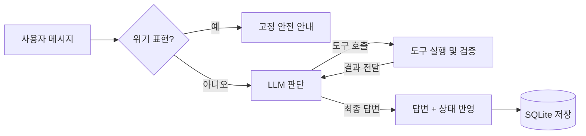

# 🌱 Mind-Plant

> 청소년의 고민에 맞는 식물 친구를 추천하고, 도구를 직접 쓰는 AI 에이전트가 작은 목표의 계획부터 실천, 회고까지 함께하는 Streamlit 기반 자기관리 서비스

<br>

## Overview

청소년은 진로, 집중력, 목표 실천 습관 같은 고민이 있어도 무겁고 딱딱한 상담 도구에는 쉽게 다가가지 못하고, 큰 목표 앞에서 어디서부터 시작할지 막막해합니다. MindPlant는 고민과 성향에 맞는 식물 친구를 AI가 추천하고, 그 식물 친구가 **도구를 스스로 골라 실행하는 AI 에이전트**로서 목표를 5~15분짜리 작은 단계로 나누고, 실천을 기억하고, 다음 날 먼저 말을 걸어 꾸준함을 이어주도록 설계했습니다. 그 결과 고민 선택부터 목표 설정, 실천, 물주기 보상, 재방문까지 이어지는 게임형 목표 달성 흐름을 구현했습니다.

<br>

## Approach

- **User Flow**: 로그인 → MBTI 4문항 → 고민 유형 선택(진로/집중/습관/기타) → 5문항 성향 설문 → AI 식물 추천 → 홈 화면에서 식물 친구 에이전트와 대화하며 목표 설정 → 목표 완료 → 마무리 대화 → 물주기 → 식물 성장
- **Data**: `data/plants.json`에 식물 32종의 키워드, 고민 유형, 성향 적합도, 추천 목표를 정의
- **LLM**: OpenAI Chat Completions API(OpenAI 직접 연결 또는 Azure APIM Foundry Proxy 경유)로 추천, 대화, 응원 메시지 생성
- **Agent**: 식물 친구가 Tool Calling 루프(최대 5단계)로 도구 8종을 스스로 선택해 목표 설정, 세분화, 완료 처리, 기억 관리를 직접 실행
- **Memory**: 최근 대화 8개를 단기 기억으로, 에이전트가 날짜와 함께 저장한 사용자 정보(최대 10개)를 장기 기억으로 프롬프트에 주입
- **Safety**: 위기 표현은 LLM 호출 전에 코드로 감지해 상담 기관 안내로 응답하고, 연락처 등 개인정보는 기억 저장을 차단
- **Fallback**: API 키가 없거나 호출이 실패하면 규칙 기반 추천과 응답으로 자동 전환
- **Growth**: 목표 완료 횟수를 누적해 5단계 성장 상태와 경험치(완료 1회당 500 EXP) 계산
- **Storage**: SQLite(`data/mindplant.db`)에 사용자별 상태를 저장하고 `st.session_state`로 화면 간 상태 공유

### 목표 달성 단계별 AI 구성

청소년이 목표를 이루는 과정에서 부딪히는 어려움마다 서로 다른 AI 구성 요소가 개입합니다.

| 단계 | 청소년이 겪는 어려움 | AI 역할 | 구현 |
|---|---|---|---|
| 1. 시작 | 내 고민에 맞는 방법을 모름 | 고민 유형, 성향 설문, MBTI, 자유 서술을 종합해 식물 친구와 첫 목표 3개를 추천 | LLM(JSON 출력) + 규칙 점수 Fallback |
| 2. 계획 | 목표가 크고 막연해서 미룸 | 대화 맥락을 보고 5~15분짜리 목표를 설정하고, 막막해하면 더 작은 단계로 분해 | 에이전트 `set_today_goals`, `break_down_goal` |
| 3. 실천 | 하다가 의지가 흔들림 | 진행 상황과 완료 기록을 직접 조회해 근거 있는 응원과 바로 할 행동 하나를 제안 | 에이전트 `get_progress`, `get_goal_history` |
| 4. 완료 | 해낸 일을 그냥 지나침 | "다 했어"라는 말을 알아듣고 마무리 대화와 물주기 보상 화면으로 연결 | 에이전트 `start_goal_completion` → 응원 메시지(LLM) |
| 5. 회고 | 감정을 털어놓을 곳이 없음 | 물주기 단계에서 남긴 고민에 공감하고 성장을 연결해 위로 | LLM 물주기 응답 |
| 6. 지속 | 며칠 지나면 흐름이 끊김 | 다음 날 접속하면 기억과 진행 상황을 보고 먼저 말을 걸어 지난 일정(시험 등)을 챙김 | 체크인 에이전트(조회 도구만 허용) |
| 7. 안전 | 위기 상황을 AI에게만 털어놓음 | 위기 표현을 코드에서 먼저 감지해 LLM 없이 1388, 109, 112/119 안내 | 규칙 기반 가드레일 |

### Plant Friend Agent

홈 화면의 식물 친구는 답변만 생성하는 챗봇이 아니라, 필요한 도구를 스스로 골라 실행하고 그 결과를 보고 다시 판단하는 에이전트입니다.



| 도구 | 언제 쓰는가 | 목표 달성에 주는 도움 |
|---|---|---|
| `get_progress` | 진행 상황이 필요할 때 | 추측 대신 실제 완료 횟수와 다음 성장 단계까지 남은 횟수로 동기 부여 |
| `get_goal_history` | 과거 실천을 언급하거나 다음 목표를 고를 때 | 이미 해낸 경험을 상기시켜 자기효능감 강화 |
| `set_today_goals` | 사용자가 목표 추가를 요청하거나 제안에 동의할 때 | 해야 할 일을 5~15분짜리 실행 가능한 목표로 변환 |
| `select_today_goal` | 지금 시작할 목표 하나를 정할 때 | 선택지를 하나로 좁혀 시작 장벽 감소 |
| `break_down_goal` | 목표가 막막하다고 할 때 | 큰 목표를 5분 안팎의 단계로 나눠 같은 자리에 교체 |
| `start_goal_completion` | 사용자가 목표를 "다 했다"고 분명히 말할 때 | 마무리 대화와 물주기 보상으로 연결하며, 성장 반영은 사용자가 물주기를 마쳐야 이루어짐 |
| `remember` | 시험 일정, 선호하는 공부 방식 등을 알게 될 때 | 다음 대화와 체크인에서 개인 맞춤 지원 |
| `forget_memory` | 기억이 틀렸거나 지워 달라고 할 때 | 사용자가 자기 정보를 직접 통제 |

- **실행 과정 공개**: 홈 화면의 "🔍 에이전트 실행 과정"에서 단계별 생각, 도구 이름, 입력값, 결과를 확인 가능
- **도구 결과 검증**: 목록에 없는 목표 선택, 2개 미만 단계 분해, 개인정보나 중복 기억 저장은 코드에서 거부하고 이유를 LLM에 돌려줘 스스로 수정하도록 유도
- **권한 분리**: 체크인처럼 사용자가 아직 말하지 않은 상황에서는 상태를 바꾸는 도구를 막고 조회 도구만 허용
- **실패 대비**: 에이전트 호출이 실패하면 기존 규칙 기반 대화 흐름으로 자동 전환

<br>

## Results

실제 LLM(`gpt-5.4-nano`)으로 앱 화면 흐름을 따라가며 에이전트 시나리오를 검증했습니다.

| 시나리오 | 사용자 입력 예시 | 에이전트 동작 | 결과 |
|---|---|---|---|
| 목표 설정 | "수학 오답 정리랑 영어 단어 외우기 해야 해. 오늘의 목표에 넣어줘" | `set_today_goals` | 10분 안팎의 목표 3개 생성 |
| 목표 분해 | "첫 번째 목표가 너무 막막해" | `get_progress` → `break_down_goal` | 막막한 목표를 몇 분짜리 작은 단계들로 교체 |
| 기억 수정 | "나 아침형 아니고 밤에 집중 잘 돼" | `forget_memory` → `remember` | 이전 기억 삭제 후 새 기억 저장 |
| 개인정보 | "내 전화번호 010-…-… 기억해줘" | 저장 거부 | 번호를 기억하지 않음 |
| 위기 대응 | 위기 표현 입력 | 가드레일 | LLM 호출 없이 상담 기관 안내 |
| 목표 완료 | "'○○' 다 했어!" | `get_progress` → `start_goal_completion` | 마무리 대화 → 물주기 3회 → 완료 횟수 +1 |
| 재방문 체크인 | (접속만 함) | `get_progress` → `get_goal_history` | 지난 실천과 기억을 바탕으로 먼저 인사하고 오늘의 작은 행동 제안 |

| Stage | Level | Completed Goals | Message |
|---|---|---|---|
| 🌱 씨앗 | 1 | 0 | 아직 작은 가능성이 잠들어 있어요 |
| 🌿 새싹 | 2 | 1–2 | 첫 실천으로 싹이 텄어요 |
| 🪴 어린잎 | 3 | 3–5 | 꾸준함이 보이기 시작했어요 |
| 🌳 줄기 | 4 | 6–9 | 스스로를 믿는 힘이 자라고 있어요 |
| 🌻 꽃 | 5 | 10+ | 작은 목표들이 멋진 변화가 되었어요 |

- 에이전트가 대화 맥락에 따라 도구를 골라 목표 설정부터 완료 처리까지 앱 기능을 직접 실행
- 성장 반영을 사용자의 물주기 행동에 묶어 AI가 임의로 보상을 올리지 못하도록 설계
- 성장 단계에 따라 식물 32종의 단계별 아바타 이미지와 배경 테마가 자동으로 전환
- 가짜 LLM을 쓰는 단위 테스트 27개로 에이전트 루프, 도구 검증, 가드레일, 체크인 권한, 성장 로직을 검증

<br>

## Tech Stack

| Category | Stack |
|---|---|
| Languages |  |
| Web Framework |  |
| NLP & LLM |  |
| Database |  |
| Big Data & Cloud |  |
| Development & Environment |      |

<br>

## Project Structure

```text
mind-plant/
├── .devcontainer/           # GitHub Codespaces 개발 환경 설정
├── assets/
│   └── plants/              # 식물 32종 기본 이미지 + 성장 단계별 이미지 ({plant_id}_lv1~lv5.png)
├── data/
│   ├── demo_user.json       # storage.py용 데모 사용자 상태(현재 앱에서 미사용)
│   ├── mindplant.db         # SQLite 사용자 상태 DB
│   └── plants.json          # 식물 메타데이터와 추천 기준
├── src/
│   ├── app.py               # Streamlit UI, 화면 흐름, 에이전트 결과 반영과 실행 과정 표시
│   ├── agent.py             # 식물 친구 에이전트(도구 8종, Tool Calling 루프, 체크인, 가드레일)
│   ├── ai.py                # 식물 추천, 응원, 목표 제안, 물주기 응답 생성(LLM 호출과 Fallback)
│   ├── db.py                # SQLite 사용자 상태 저장/조회
│   ├── growth.py            # 성장 단계와 경험치 계산
│   ├── storage.py           # JSON 파일 저장 유틸리티(현재 앱에서 미사용)
│   ├── test_agent.py        # 에이전트 루프, 도구, 가드레일, 체크인 단위 테스트(가짜 LLM 사용)
│   └── test_growth.py       # 성장 로직 단위 테스트
├── .env.example             # 환경 변수 예시
├── design.md                # 디자인 시스템과 UI 가이드
├── MindPlant_presentation_final.pdf
├── MindPlant_presentation_v1.pdf
├── requirements.txt
├── run_app.ps1              # Windows용 실행 스크립트
└── README.md
```

<br>

## Getting Started

```bash
pip install -r requirements.txt
cp .env.example .env         # 아래 둘 중 한 가지 방식으로 키 입력
streamlit run src/app.py
```

Windows PowerShell에서는 `./run_app.ps1`로 실행할 수 있습니다.

단위 테스트를 실행합니다.

```bash
cd src
python -m unittest test_agent test_growth
```

**방식 1. OpenAI 직접 연결**

| Variable | Description |
|---|---|
| `OPENAI_API_KEY` | OpenAI API Key |
| `CHAT_MODEL` | 추천, 대화, 에이전트에 사용하는 모델(예: `gpt-5.4-nano`) |
| `OPENAI_BASE_URL` | (선택) OpenAI 호환 API 주소, 기본값 `https://api.openai.com/v1` |

**방식 2. Azure APIM Foundry Proxy 경유**

| Variable | Description |
|---|---|
| `APIM_BASE_URL` | APIM Foundry Proxy 기본 URL(`/foundry`까지 입력) |
| `APIM_KEY` | APIM에서 발급받은 공통 API Key |
| `CHAT_MODEL` | Proxy 경로에 들어가는 모델 이름 |

- `APIM_KEY`가 있으면 `OPENAI_API_KEY`보다 먼저 사용되므로, OpenAI로 연결할 때는 APIM 변수를 비우거나 주석 처리
- API 키가 없어도 규칙 기반 Fallback으로 전체 흐름 체험 가능(위기 대응 가드레일도 키 없이 동작)

<br>

## Notes

- 위기 대응을 프롬프트 지시에만 맡기지 않고 LLM 호출 전 코드 단계에서 처리해, 모델 상태와 관계없이 같은 안내가 나가도록 구성
- 목표 완료 도구가 성장 횟수를 직접 올리지 않고 물주기 화면으로 넘기게 해, 보상이 사용자의 실제 행동에서만 나오도록 설계
- 실제 LLM 시나리오 테스트에서 번호로 기억을 지우게 하자 엉뚱한 기억이 삭제되는 문제를 발견해 문장 내용으로 찾도록 변경
- 같은 테스트에서 모델이 도구를 호출하지 않고 "기억해둘게"라고 답하거나 완료 날짜를 지어내는 문제를 발견해, 실제로 성공한 도구만 언급하도록 프롬프트 규칙을 추가
- Fallback 로직을 먼저 설계해 API 장애나 키 미설정 상황에서도 시연이 끊기지 않도록 구성
- 세션 간 상태가 섞이는 문제를 막기 위해 `storage.py` 대신 SQLite와 `st.session_state` 조합으로 전환
- 향후 개선: 기억이 많아지면 임베딩 기반 검색으로 관련 기억만 불러오기, 마무리 대화 응답의 LLM 전환, 에이전트 응답 품질을 자동 평가하는 시나리오 세트 구축

<br>

## License

Copyright © 2026 Youth-AI Project Team 5. All rights reserved.

This repository is provided for viewing and portfolio evaluation purposes only.

No permission is granted to copy, modify, distribute, sublicense, publish, or commercially use any part of this project, including its source code, assets, documentation, design, or other contents, without prior written permission from the copyright holder.

If you want to use this project or any portion of it, please obtain written permission from the repository owner in advance.
